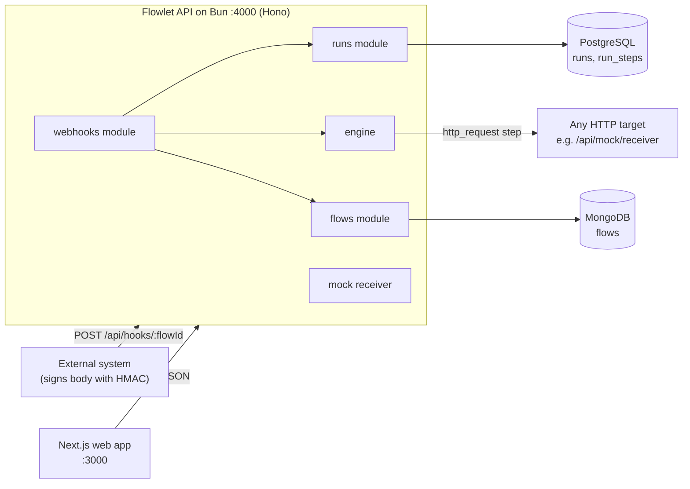
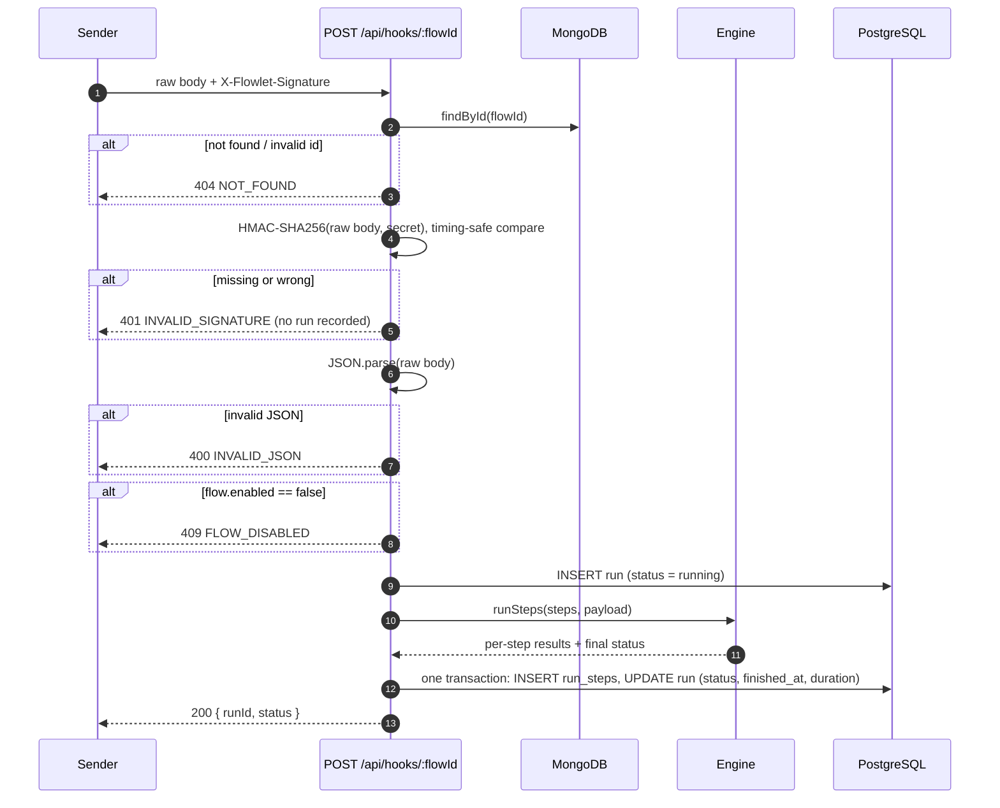
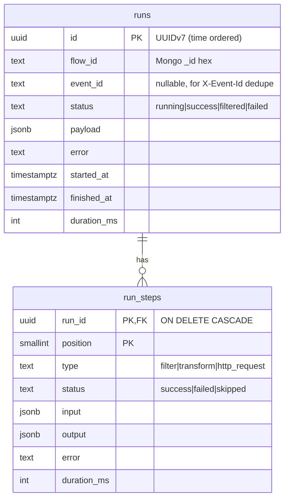

# Architecture

## 1. Big picture



- **MongoDB** holds flow definitions. A flow is one self-contained document: its steps are an
  embedded array with a different shape for each step type. It is read as a whole and
  replaced as a whole.
- **PostgreSQL** holds run history. Runs and steps are append-heavy, relational
  (run 1→N steps), filtered, paginated and aggregated. That is SQL's home ground.
- The two stores are linked only by `flow_id` (the Mongo `_id` as a hex string). There is no
  cross-database foreign key, so the application keeps them consistent (see
  [decisions.md](decisions.md#flow-deletion)).

## 2. Repository layout

```
.
├─ package.json             # Bun workspaces + root scripts: dev, migrate, test, typecheck
├─ bun.lock
├─ tsconfig.base.json       # strict settings shared by every package
├─ docker-compose.yml       # MongoDB + PostgreSQL (with healthchecks)
├─ .env.example
├─ docs/                    # this folder
├─ packages/
│  └─ shared/               # @flowlet/shared: Zod schemas + inferred types (API and web)
│     └─ src/
│        ├─ step.ts         # step schemas (filter, transform, http_request)
│        ├─ flow.ts         # create/update/list/detail schemas
│        ├─ run.ts          # run + step record types, status enums, query schema
│        ├─ error.ts        # ApiErrorBody type + error codes
│        └─ index.ts
└─ apps/
   ├─ api/                  # @flowlet/api: Hono on Bun, port 4000
   │  ├─ migrations/        # 0001_init.sql, ... (committed, applied in order)
   │  ├─ scripts/migrate.ts # waits for DBs, applies SQL migrations, ensures Mongo indexes
   │  ├─ src/
   │  │  ├─ index.ts        # entry: connect DBs, build app, Bun.serve
   │  │  ├─ app.ts          # createApp(deps): pure, used by tests too
   │  │  ├─ config.ts       # typed env (validated with Zod)
   │  │  ├─ lib/            # ApiError, error handler, validation helpers, json body parser
   │  │  ├─ db/             # mongo.ts, postgres.ts (clients + lifecycle)
   │  │  └─ modules/
   │  │     ├─ flows/       # repository (Mongo) + routes
   │  │     ├─ engine/      # path, filter, transform, http-request, runner
   │  │     ├─ webhooks/    # signature + trigger route
   │  │     ├─ runs/        # repository (Postgres), cursor, routes
   │  │     └─ mock/        # /api/mock/receiver
   │  └─ test/              # bun test files
   └─ web/                  # @flowlet/web: Next.js App Router, port 3000
      └─ src/
         ├─ app/            # routes: /flows, /flows/new, /flows/[id], /flows/[id]/edit, /runs/[id]
         ├─ components/     # FlowForm, StepEditor, RunTimeline, StatusBadge, states, ...
         └─ lib/            # typed API client, useApi hook, HMAC signing, formatting
```

The rule for layering in the API: **routes → services/repositories → db**. Routes do HTTP only
(parse, validate, status codes). Repositories do storage only. The engine is pure logic with
no database or HTTP framework imports, so it is the easiest part to unit test.

## 3. Webhook request lifecycle



The order of checks follows the table in the brief: 404 → 401 → 400 → 409. The signature is
checked **before** JSON parsing because it is computed over the raw bytes. Disabled is checked
**after** the signature, so an unauthenticated caller cannot learn whether a flow is enabled.

## 4. Data model

### MongoDB: `flows` collection

```ts
interface FlowDocument {
  _id: ObjectId;
  name: string;                // 3..80 chars, trimmed
  description: string | null;  // optional, max 500 chars
  enabled: boolean;
  steps: Step[];               // 1..5, discriminated union on `type`
  webhookSecret: string;       // 32 random bytes, hex, generated on create, never accepted from client
  createdAt: Date;
  updatedAt: Date;
}
```

Index: `{ createdAt: -1, _id: -1 }`. It serves the flow list: `find({}, projection).sort({ createdAt: -1, _id: -1 }).limit(100)`.

### PostgreSQL



Indexes and the query each one serves are listed in [modules/runs.md](modules/runs.md#indexes).

## 5. API contract

The backend listens on **4000**. All paths and shapes are exactly as in the brief.

| Method and path | Success | Errors |
| --- | --- | --- |
| `POST /api/flows` | 201 flow (with steps and `webhookSecret`) | 400 |
| `GET /api/flows` | 200 array of flow summaries (no steps, no secret) | |
| `GET /api/flows/:id` | 200 flow with steps and `webhookSecret` | 404 |
| `PATCH /api/flows/:id` | 200 updated flow | 400, 404 |
| `DELETE /api/flows/:id` | 204 | 404 |
| `POST /api/hooks/:flowId` | 200 `{ runId, status }` | 404, 401, 400, 409 |
| `GET /api/flows/:id/runs?status=&limit=&cursor=` | 200 `{ items, nextCursor }` | 400, 404 |
| `GET /api/runs/:runId` | 200 run with `steps` | 404 |
| `GET /api/flows/:id/stats` | 200 `{ total, success, failed, filtered, avgDurationMs, lastRunAt }` | 404 |
| `POST /api/mock/receiver` | 200 echo of the body; `?fail=1` → 500 | |

Every error uses one shape:

```json
{ "error": { "code": "VALIDATION_ERROR", "message": "Name must be at least 3 characters", "details": {} } }
```

| Code | HTTP | When |
| --- | --- | --- |
| `VALIDATION_ERROR` | 400 | Body or query fails Zod validation. `details.issues` lists `{ path, message }` |
| `INVALID_JSON` | 400 | The body is not valid JSON |
| `INVALID_SIGNATURE` | 401 | Signature header missing, malformed or wrong |
| `NOT_FOUND` | 404 | Unknown flow, run or route (also an id that is not a valid ObjectId/UUID) |
| `FLOW_DISABLED` | 409 | A webhook was sent to a disabled flow |
| `PAYLOAD_TOO_LARGE` | 413 | Body over 1 MB |
| `INTERNAL_ERROR` | 500 | Anything unexpected. The message is generic and the details are logged server side |

## 6. Run commands (from a fresh clone)

```
cp .env.example .env
docker compose up -d        # MongoDB and PostgreSQL
bun install
bun run migrate             # waits for both DBs, applies SQL migrations, creates Mongo indexes
bun run dev                 # backend on 4000, web on 3000
bun test
```
